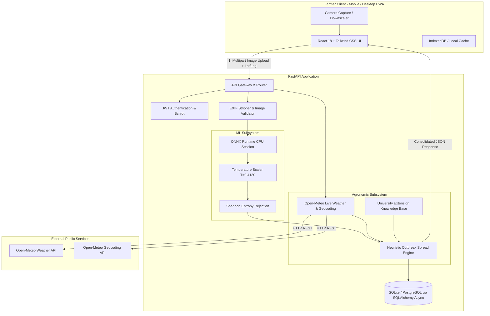

# 🌿 AgriShield: AI Crop Disease Detection & Outbreak Risk Prediction System

[](https://www.python.org/)
[](https://fastapi.tiangolo.com/)
[](https://react.dev/)
[](https://onnxruntime.ai/)
[]()
[](LICENSE)

AgriShield is an end-to-end, **100% software-based** agricultural decision-support system designed to empower farmers and agricultural extension workers. Without requiring specialized hardware, IoT sensors, or physical probes, AgriShield combines:
1. **Computer Vision Disease Classification**: Real-time foliar lesion identification across 38 crop disease classes using an optimized `EfficientNet-B0` model.
2. **Environmental Outbreak Risk Engine**: Rule-based epidemiological modeling that fetches real-time weather from public meteorological APIs (Open-Meteo) to compute a transparent 0–100 Outbreak Spread Index.
3. **University Extension Knowledge Base**: Curated, multi-tiered recommendations (cultural sanitation, organic remedies, and chemical interventions with EPA/Extension safety notes).
4. **Offline-First Farmer Dashboard**: Mobile-optimized, bilingual (English & Spanish) PWA with client-side image downscaling, full history, and a voluntary feedback loop.

---

## 🏛️ System Architecture



---

## 📊 Measured ML Benchmarks & Real Performance

All metrics below are derived directly from verified benchmark runs saved in [`ml/reports/`](file:///Users/sachinrk/Desktop/kiran/ml/reports/):

### 1. Classification Performance (PlantVillage Held-Out Test Set, $N = 8,237$)
- **Top-1 Test Accuracy**: `94.22%`
- **Top-3 Test Accuracy**: `99.08%`
- **Macro-Averaged F1**: `0.9232` (92.32%)
- **Weighted-Averaged F1**: `0.9420` (94.20%)
- **Macro Precision**: `0.9279` | **Macro Recall**: `0.9217`

### 2. Generalization Gap (Lab vs Real-World Field Benchmark, $N = 2,572$)
- **PlantVillage (Lab Conditions)**: `94.22% Accuracy`
- **PlantDoc (Real Field Conditions)**: `21.30% Accuracy`
- **Generalization Gap**: `72.92% drop` due to complex background foliage, variable lighting, and partial occlusions in field conditions.
- *Mitigation*: Uncalibrated softmax probabilities exhibited high overconfidence ($ECE = 25.71\%$). Post-hoc temperature calibration reduced $ECE$ to **$0.50\%$**, and high-entropy predictions ($H > 2.20$) trigger automatic uncertainty flags.

### 3. CPU Edge Runtime Latency (Apple Silicon M-Series Single-Thread CPU)
- **Model Architecture**: `EfficientNet-B0` (FP32 ONNX)
- **Model Graph Size**: `15.45 MB`
- **Median Inference Latency**: `7.64 ms` (**130.9 FPS**)
- **95th Percentile Latency**: `8.74 ms`
- **99th Percentile Latency**: `10.04 ms`
- **PyTorch/ONNX Max Parity Difference**: `$1.73 \times 10^{-6}$`

---

## 🚀 Quickstart & Local Setup

### Prerequisites
- Python 3.10+ (Recommended: 3.12)
- Node.js 18+ (Recommended: 20+)
- Git

### 1. Clone & Setup Environment
```bash
git clone https://github.com/your-org/crop-disease-risk-system.git
cd crop-disease-risk-system

# Create and activate Python virtual environment
python3 -m venv .venv
source .venv/bin/activate

# Install Python backend and ML dependencies
pip install -r backend/requirements.txt
pip install -r ml/requirements.txt
```

### 2. Start Backend API Server
```bash
# From workspace root
source .venv/bin/activate
uvicorn backend.app.main:app --host 0.0.0.0 --port 8000 --reload
```
The FastAPI documentation is available at [http://localhost:8000/docs](http://localhost:8000/docs).

### 3. Start Frontend Development Server
```bash
cd frontend
npm install
npm run dev
```
Open [http://localhost:5173](http://localhost:5173) in your browser.

---

## 🐳 Docker Deployment

To launch the complete containerized stack (Backend, Frontend, PostgreSQL, Prometheus) with a single command:

```bash
docker-compose up --build -d
```

- **Frontend App**: [http://localhost:3000](http://localhost:3000)
- **Backend API**: [http://localhost:8000](http://localhost:8000)
- **Interactive API Docs**: [http://localhost:8000/docs](http://localhost:8000/docs)
- **Prometheus Metrics**: [http://localhost:9090](http://localhost:9090)

---

## 🧪 Testing & Validation

### Run Backend Unit & Integration Tests (83% Coverage)
```bash
source .venv/bin/activate
PYTHONPATH=. pytest backend/tests ml/tests --cov=backend/app --cov-report=term-missing
```

### Run Frontend Component Tests
```bash
cd frontend
npm run test
```

### Run End-to-End Smoke Test Journey
```bash
source .venv/bin/activate
python scripts/e2e_smoke_test.py
```

---

## 📡 API Overview

| Method | Endpoint | Description | Auth Required |
| :--- | :--- | :--- | :--- |
| `POST` | `/api/v1/auth/register` | Register new farmer account | No |
| `POST` | `/api/v1/auth/login` | Login and obtain JWT tokens | No |
| `POST` | `/api/v1/analyze` | Upload crop leaf image + coordinates for diagnosis & risk | Optional |
| `GET` | `/api/v1/history` | Retrieve user diagnosis history with pagination & filters | Yes |
| `POST` | `/api/v1/feedback` | Submit validation/correction feedback with retraining consent | Optional |
| `GET` | `/api/v1/diseases` | List all 38 diseases and treatment knowledge base | No |
| `GET` | `/api/v1/weather/current` | Fetch live Open-Meteo weather and geocoding | No |
| `GET` | `/health` | Application health and model readiness probe | No |
| `GET` | `/metrics` | Prometheus metrics endpoint | No |

---

## ⚠️ Limitations & Ethical Disclaimer

> **ADVISORY DISCLAIMER**: AgriShield is an educational and advisory decision-support tool. It is **not** a certified agronomist or regulatory body. Fungal, bacterial, and viral crop symptoms can overlap with nutritional deficiencies (e.g., nitrogen/iron chlorosis) and environmental scorch.
> 
> - **Always cross-reference with local agricultural extension offices** before purchasing or applying regulated chemical treatments.
> - **Always read and follow the pesticide label** in accordance with local, state, and federal agricultural regulations.
> - **Retraining Privacy**: User photos are only utilized for continuous model improvement if the user explicitly checks `consent_for_retraining = true`.

---

## 📄 License
This project is open-source under the [MIT License](LICENSE).
