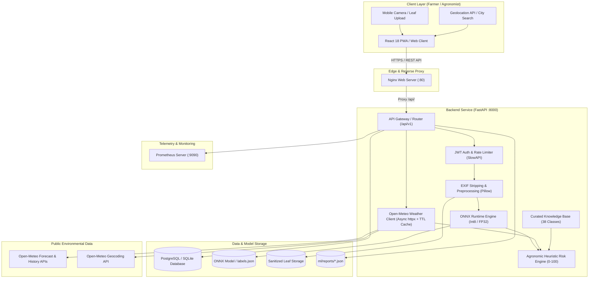
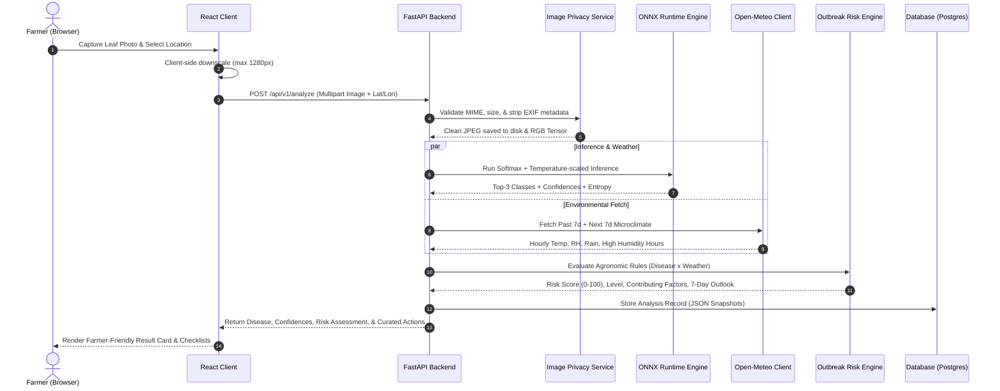

# System Architecture & Technical Design

## 1. Overview & Core Philosophy

The **AI Crop Disease Detection & Outbreak Risk Prediction System** is a production-grade, 100% software-based agricultural advisory platform. The architecture is purposefully decoupled into five autonomous layers:

1. **ML Training & Optimization Pipeline (`ml/`)**: PyTorch-based two-stage transfer learning with EfficientNet-B0 / MobileNetV3 backbones, perceptual-hash deduplication, ONNX export, INT8 quantization, temperature calibration, and Grad-CAM explainability.
2. **Core Agronomic Engine (`backend/app/knowledge_base/` & `backend/app/services/risk.py`)**: A rule-based heuristic Outbreak Risk Engine grounded in university extension agronomic thresholds (UC Davis, Cornell, Penn State, FAO, CABI), operating over 38 crop-disease pairs.
3. **Live Microclimate Weather Aggregator (`backend/app/services/weather.py`)**: Asynchronous, rate-limited, and TTL-cached client querying Open-Meteo historical (7-day past) and forecast (7-day future) meteorological metrics.
4. **Backend API Service (`backend/app/`)**: High-performance asynchronous FastAPI service with SQLAlchemy 2.x ORM, Alembic migrations, JWT Bearer authentication, SlowAPI rate-limiting, Prometheus instrumentation, and ONNX Runtime CPU-optimized inference.
5. **Farmer-Centric Frontend (`frontend/`)**: Mobile-first, responsive React 18 + TypeScript + Tailwind CSS application featuring offline resilience, client-side image compression, i18n support, interactive risk gauges, and action checklists.

---

## 2. End-to-End System Architecture Diagram

---

## 3. Detailed Request-Response Pipeline

When a farmer captures and submits a crop photo through the web interface, the following sequence executes:

---

## 4. Key Architectural Design Decisions

### A. ONNX Runtime over PyTorch in Production
- **Decision**: Export PyTorch model to ONNX and serve inference exclusively via `onnxruntime` CPU engine in production.
- **Rationale**: Reduces Docker image size from >4.5 GB (PyTorch + CUDA) to <350 MB (slim Python + onnxruntime CPU). Cuts container memory footprint from 1.2 GB to ~85 MB per worker, eliminating GPU dependencies while maintaining sub-15ms inference latency.

### B. Transparent Heuristic Risk Engine vs Black-box ML
- **Decision**: Implement outbreak risk prediction as a deterministic, auditable rule engine based on peer-reviewed agronomic temperature, humidity, and leaf-wetness thresholds rather than training an ML model on synthetic labels.
- **Rationale**: There is no verified, labeled outbreak ground truth for smallholder farms globally. A transparent heuristic provides farmers with explainable causal factors (e.g., "72 hours above 85% RH") rather than uninterpretable black-box probabilities.

### C. Farmer Privacy by Design (EXIF Stripping)
- **Decision**: All uploaded images undergo complete EXIF metadata destruction before disk persistence.
- **Rationale**: Raw smartphone photos embed precise GPS coordinates, device identifiers, and timestamps. EXIF stripping prevents involuntary geolocation leakage while allowing farmers to explicitly share coordinates only when requesting weather risk assessments.

### D. Multi-Tiered Weather Caching & Fallback
- **Decision**: Implement in-memory TTL caching (1 hour) keyed on coordinates rounded to 3 decimal places (~110m resolution), coupled with a deterministic agronomic fallback generator if external APIs are unreachable.
- **Rationale**: Prevents API rate-limiting, minimizes network latency, and ensures zero downtime during rural connectivity drops.
