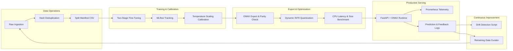

# MLOps, Model Lifecycle & Monitoring

## 1. MLOps Lifecycle Overview

---

## 2. Model Versioning & Artifacts

Every deployed model artifact is tracked via:
1. `ml/models/model_version`: Semantic version string (e.g. `v1.0.0_efficientnet_b0`).
2. `ml/models/labels.json`: Authoritative 38-class index-to-label mapping.
3. `ml/models/crop_disease_model.onnx`: Optimized FP32 computational graph.
4. `ml/models/crop_disease_model_int8.onnx`: Quantized INT8 graph for ultra-low latency.
5. `ml/reports/MODEL_CARD.md`: Comprehensive model card with intended use, metrics, and failure modes.

The backend exposes the active model version at startup and logs it with every diagnosis record (`Analysis.model_version`).

---

## 3. Telemetry & Observability (Prometheus)

The FastAPI application is instrumented with `prometheus-fastapi-instrumentator`, exposing real-time metrics at `/api/v1/metrics`:

- `http_requests_total`: Total request volume by endpoint and HTTP status code.
- `http_request_duration_seconds`: Request latency distribution (p50, p90, p99).
- `prediction_uncertain_total`: Rate of low-confidence / high-entropy predictions flagged as uncertain.
- `weather_api_failure_total`: Failures in fetching live Open-Meteo environmental data (triggering agronomic fallbacks).

---

## 4. Drift Detection (`ml/src/monitor_drift.py`)

In-situ distribution shift is calculated between production inference logs and baseline training class distributions using **Jensen-Shannon (JS) Divergence**:

$$D_{JS}(P \parallel Q) = \frac{1}{2} D_{KL}(P \parallel M) + \frac{1}{2} D_{KL}(Q \parallel M)$$

Where $M = \frac{1}{2}(P + Q)$. An alert threshold is triggered if $D_{JS} > 0.25$, indicating significant seasonal or geographic crop distribution shifts.

---

## 5. Retraining Workflow (`ml/src/retrain.py`)

Farmers can submit diagnosis verification feedback through the UI (`POST /api/v1/history/{id}/feedback`).
1. **User Consent**: Images are included in retraining datasets **only** if the farmer explicitly opted in (`consent_for_retraining = true`).
2. **Quality Filtering**: Retraining merges only confirmed, verified corrections.
3. **Sampling Bias Disclaimer**: Field-submitted feedback is subject to reporting bias (farmers are more likely to report surprising or incorrect diagnoses). Retraining scripts account for this by down-weighting over-represented classes.
